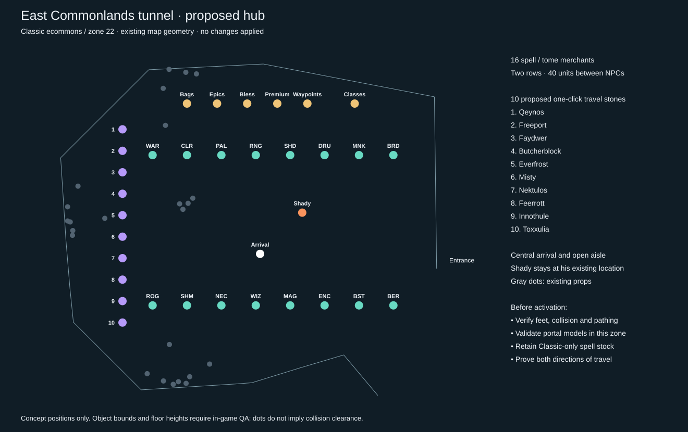

# East Commonlands tunnel hub proposal

September 19, 2026. Assessment only; no spawns, doors, bind points, starting
zones or characters have been moved.

The classic East Commonlands tunnel is a workable candidate for a smaller,
cozier hub. Use **ecommons, zone 22**, not the revamped Commonlands or Old
Commonlands. The live Shady Swashbuckler is NPC 22089 at approximately
**x -141, y -1677, z 3.75**. Leave him in place.

## Proposed arrangement

Use the large chamber west of the tunnel entrance. Two rows of eight spell/tome
merchants have **40 units between centers**, compared with 24 in the current
PoK grid. The center remains an arrival and walking area, with the eastern
entrance and southern passage clear of proposed services.

| Service | Proposed server coordinates | Purpose |
|---|---|---|
| Merchants 1–8 | x -315 to -35 in steps of 40; y -1610 | Northern row, facing into chamber |
| Merchants 9–16 | x -315 to -35 in steps of 40; y -1785 | Southern row, facing into chamber |
| Travel stones 1–10 | x -350; y -1580 to -1805 in steps of 25 | Western wall, one click per destination |
| Bags, epics, blessings, premium, waypoints | x -275 to -135 in steps of 35; y -1550 | Services along the back |
| Class guide | x -80, y -1550 | Back wall, distinct from spell sellers |
| Arrival | x -190, y -1725 | Clear central space |

These are concept coordinates, not migration SQL. Actual feet, facing, model
bounds, line of sight and walking paths need grounding and in-game checks.
The survey includes 24 existing props: carts, crates, lean-tos, chairs and
grates. In particular, inspect the western travel stones near the grate at
(-371, -1684) and the northern merchants near the cart at (-300, -1575).

Proposed direct destinations are Qeynos, Freeport, Greater Faydark,
Butcherblock, Everfrost, Misty Thicket, Nektulos, Feerrott, Innothule and
Toxxulia. Use safe, verified landing locations and provide a return route.
These cover Classic travel without unlocking later expansions. Existing
waypoint progression remains a separate service. Final destination coordinates
and return-door locations are not yet selected or applied.

## What moving it requires

1. Preserve the current 16 merchant identities, 1,747 listings and 1,229 unique
   items, including the existing Classic/level-50 catalog policy. Relocation
   must not change spell/tome availability, prices or quest item ownership.
2. Copy the required quest bindings into ecommons and retest class selection,
   release, blessings, bags, epics and waypoints there. Some current service
   scripts are zone-local; moving spawn coordinates alone is insufficient.
3. Extend the signed client package to load the five exotic service models in
   ecommons. Its current character import file does not include the PoK hub's
   model set. Verify the exact model/gender/texture combinations in this zone.
4. Prototype a clickable travel object in the exact client. PoK uses door
   objects with native destination data, but their geometry is not established
   as loaded in ecommons. A database door row alone does not prove a visible,
   clickable portal. Include any required zone object assets in the patcher.
5. Generate guarded forward/rollback SQL from a fresh snapshot. Handle only
   affected non-corpse saved spawn state in both zones and the correct instance;
   retain unrelated state. Back up before writes.
6. Change new-character starts and the return-home destination explicitly.
   Do not mass-move existing characters or overwrite player bind points.
7. Run owner QA from a normal account: fresh character arrival, every merchant,
   every travel stone and return route, three-pet pathing through both passages,
   class selection, relog, and visibility with the supported model settings.

Recommendation: prototype this arrangement as the next QA candidate after the
pet release. Keep PoK available until the tunnel's travel, stock and rendering
checks pass. The read-only survey is retained locally under
`artifacts/multiclass-pets-20260919/tunnel/`; the drawing uses the installed
ecommons map and live object positions, not an imagined replacement zone.
