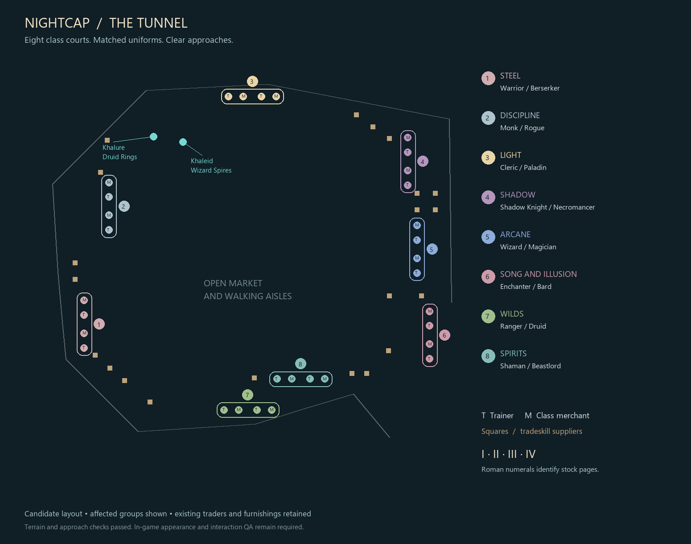

# Tunnel class courts and Khaleid

September 30, 2026 candidate. **Not deployed; in-game acceptance is open.**
Based on a read-only OVH capture, not the older local PEQ services roster.
No production files or SQL were changed.



## Scope

- Sixteen trainer/shop pairs form eight courts: Steel, Discipline, Light, Shadow,
  Arcane, Song and Illusion, Wilds, and Spirits. Each class pair shares a familiar
  playable race and armor material/color/size, with male/female variation.
- Twenty-two suppliers use profession outfits. Fourteen spillover subtitles use
  I–IV. Bartholomew becomes a Halfling. Stock, prices and class functions stay intact.
- Khalure (999525) moves to X=-311,Y=-1561,Z=3.75 with `Druid Rings`. His script,
  era restrictions and Lavastorm readiness gate are unchanged.
- Khaleid (999527), X=-279,Y=-1567,Z=3.75, is a male Dark Elf wizard with `Wizard
  Spires`, Carmine Robe material 15/RGB 175,10,50 and Blue Crystal Staff IT122.
  These come from captured Classic item IDs 1226/14337 and create no drops, player
  item definitions or power. He offers eight explicit Classic wizard destinations.
- Other named residents retain the previous lineup. Existing traders, walkers,
  stations, utility functions and client files remain unchanged.

Race choices are recognizable archetypes, not measured popularity statistics.
[Design and alternatives](../../adr/0049-tunnel-class-courts.md). Wall signs are
optional: the existing archive lacks class-sign actors; they need packaged
geometry/materials as described by the [EQEmu custom-zone guide](https://docs.eqemu.dev/client/guides/custom-zone-editing/)
and [Blender object properties](https://docs.eqemu.dev/client/eqgzi/blender-custom-properties/).
Blender MCP was disconnected; Unity tools were not exposed. This candidate uses
uniforms and native subtitles and requires no client patch.

## Verification

- 13 new Python checks preserve trainer/shop functions, stock links, stats,
  matching uniforms, Roman pages, display-only gear and scoped recovery.
- 19 MariaDB checks on captured production schemas in a disposable local database:
  exact apply/rollback, case-only drift/replay/orphan rejection, fresh recovery
  after zone activity and preservation of unrelated/corpse/other-instance states,
  inventory, currency, stock and era-rule sentinels.
- 26 wizard quest assertions, 21 existing druid/resident assertions, 8 existing
  service planner tests and 4 runtime-path regression tests pass. These tests do not prove deployed
  quest loading or rendered gameplay.
- 550 court ground/headroom samples, 55 clear approach rays and 40 samples for
  eight wizard landings pass. Patrol clearance is at least 12.122 world units;
  small props get 10 units, carts/lean-tos 15, NPCs/stations 12. The full native
  NPC roster is included, and continuous service frontages clear NPCs by 8 units,
  small props by 6 and carts/lean-tos by 11. Actual patrol modes must match the
  verified reversing routes. Regression tests reject incomplete roster captures.
- All nine tested map hashes match production, including its configured
  `nektulos_classic.map`. [Hashes](map-hashes.json), [geometry](geometry-summary.json),
  [database checks](database-checks.json).

Local raw capture, exact SQL, preimages/afterimages and detailed probes:
`E:/EQ_Local_Dev/artifacts/tunnel-class-courts/`. The capture was live and is
**rehearsal input only**. No player/account tables were captured. Do not apply its
saved-state preimages after later activity.

Reproduce from the repo root:

```powershell
python -B -m unittest discover -s tools/tests -p test_tunnel_courts.py
python -B -m unittest discover -s tools/tests -p test_tunnel_services.py
perl tools/tests/tunnel_spires_quests.t ABSOLUTE_SERVER_MODS_DIRECTORY
perl tools/tests/tunnel_residents_quests.t ABSOLUTE_SERVER_MODS_DIRECTORY
python tools/tests/rehearse_tunnel_courts.py --source FRESH_SCOPED_CAPTURE.json --evidence NEW_DIRECTORY
python tools/tests/probe_tunnel_courts.py --snapshot FULL_TUNNEL_CAPTURE.json --zone-metadata TARGET_ZONES.json --evidence NEW_DIRECTORY
```

## Deployment and recovery

Normal feature → dev → test → main policy applies. Current owner sign-off is
required for main/OVH; previous release exceptions are not general approval.
No native build, shared-memory rebuild or client publication is required.

1. At authorized activation, retain the three runtime file preimages and take a
   verified full PEQ backup. Close access and gracefully stop game writers before
   final capture; shutdown must not recreate obsolete saved states.
2. Use `tools/tunnel_courts.py:capture(query)` against the actual target. Default
   `--capture` is **local akk-stack only**. For production, provide its query
   adapter and save the returned JSON. Recapture furniture/patrol/other-NPC and
   zone metadata; repeat geometry/map-hash checks. Review any unexpected drift.
3. Generate `python tools/tunnel_courts.py --source TARGET_CAPTURE.json --output
   NEW_DIRECTORY`. Rehearse on those schemas, then apply generated `forward.sql`.
   Never bypass exact-row, reference, engine or saved-state guards.
4. Install `tunnel_spires.pl` and `tunnel_spire_data.pl` in the active plugin path
   resolved from `server.directories.plugin_paths`/`plugins`, and `999527.pl` in
   active `quests/ecommons`. Production uses `data/server/plugins`, **not**
   `data/server/quests/plugins`. Verify the configured paths and installed hashes.
5. Start game, check static afterimages, preserved stock/rules, health and actual
   plugin loading, then reopen access and execute QA below. NPC cache changes
   require a zone restart; `#repop` alone is insufficient.

The generated `rollback.sql` is immediate recovery only. After zone activity,
stop writers and generate from fresh content:

```powershell
python tools/tunnel_courts.py --source CURRENT_STOPPED_CAPTURE.json --rollback-from ORIGINAL_GENERATION_DIRECTORY --output NEW_RECOVERY_DIRECTORY
```

The new directory's `forward.sql` restores original static content and clears
only unambiguous affected NPC states. Restore runtime preimages/remove only newly
added files, restart and verify. Corpse/other-zone/other-instance references or
static drift stop recovery. Never restore the full DB over later play or delete
unrelated saved states.

## Exact owner in-game QA

Use a normal account/current signed client in ecommons (22), instance zero.
Start with Classic models; repeat appearance checks in modern mode if supported.
Database coordinates are X,Y,Z; `/loc` reports Y,X,Z.

1. Walk from the southeast approach through the market and around all eight
   courts. Check walls, carts, chairs and six stations for clipping, floating,
   invisible models, Human fallbacks, blocked approaches and overlapping labels
   at a normal camera distance. Watch a full walker patrol cycle.
2. At **all sixteen class pairs**, verify matching race/armor/colors and readable
   subtitles. Right-click every trainer: correct training window, including held
   secondary/tertiary classes. Shop every merchant: original spell/song/tome stock
   and prices; buy a legal inexpensive item.
3. Check Smithing I–III, Baking I–II, Alchemy I–IV, Poison I–II and Research I–III.
   Every page remains separately shoppable with its prior stock. Check single-page
   suppliers and open all six crafting-station windows.
4. Khalure at `/loc -1561,-311,3.75`: `Druid Rings` displays. Hail and take West
   Commonlands, then return. All ring/era/Lavastorm gates behave as before.
5. Khaleid at `/loc -1567,-279,3.75`: Dark Elf male, Carmine robe, Blue Crystal Staff,
   `Wizard Spires`. Hail offers exactly Toxxulia, North Karana, Greater Faydark,
   Nektulos, Cazic Thule, West Commonlands, North Ro and West Karana. No raid planes
   or later expansions. The Cazic destination is labelled dangerous.
6. Test each wizard route with prepared characters and return using existing
   travel. Arrive at the Classic spires/portal with correct terrain and a grounded
   character. Cazic Thule is a hostile temple; prepare accordingly.
7. At Khaleid, combat/casting/incapacitation and rapid repeat clicks must not yield
   travel escapes or duplicate zoning. Invalid/stale destination commands do not
   port. Give an unwanted item and small coin amount: native hand-in returns both.
   Verify hail after a fresh zone boot; mocked Perl does not prove plugin loading.
8. Zone out/back and restart the test zone: positions/appearances persist with no
   old-state duplicates or second Khaleid. Confirm Merrin, other named residents,
   return books, utilities and finite traders retain existing behavior. Record
   screenshots, NPC IDs and `/loc` for issues.

No manual acceptance is claimed by the automated checks.
