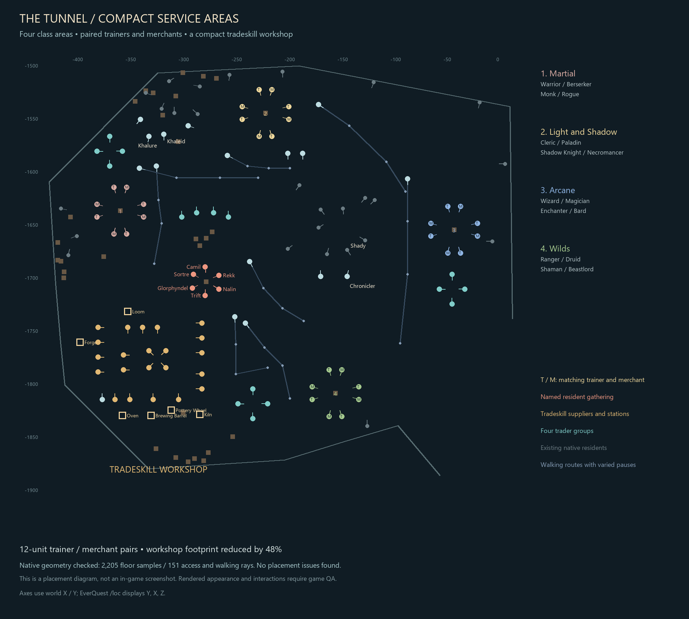

# Compact tunnel services — October 2, 2026

The owner accepted the six-resident campfire group and requested the same
intentional organization for trainers, spell merchants and tradeskills. This
revision is prepared for the already-authorized main/server deployment. Visual
acceptance of the new service layout remains open.

## Layout

All 119 actors remain. Each of the 16 trainers stands 12 units from its matching
merchant. Four pairs share each of four compact areas, facing a small native
campfire. The 22 tradeskill suppliers and six functional stations occupy a
115-by-98-unit workshop, roughly 48% less area than the previous arrangement.
Smithing, baking, brewing and pottery suppliers stand beside their stations;
alchemy, poison and research pages remain adjacent groups. The Epic Forgemaster
joins the workshop. Sixteen traders gather into four groups near the west wall,
central crates, arcane area and south cart. Eight walking routes avoid the new
gatherings and station approaches.

| Area | Classes | Center in EQ `/loc` order Y, X |
|---|---|---|
| Martial | Warrior, Berserker, Monk, Rogue | -1640, -355 |
| Light and Shadow | Cleric, Paladin, Shadow Knight, Necromancer | -1548, -218 |
| Arcane | Wizard, Magician, Enchanter, Bard | -1658, -40 |
| Wilds | Ranger, Druid, Shaman, Beastlord | -1812, -152 |
| Tradeskill workshop | All 22 suppliers, six stations, Epic Forgemaster | approximately -1784, -336 |

The six accepted residents and their fire retain their exact poses and appearance.
The 26 native actors retain established service positions. NPC names, Roman
spillover suffixes, subtitles, stock links, costumes, hails and travel behavior
are unchanged. No client update is needed: class landmarks reuse the installed
native CAMPFIRE at size 45. There are no new gameplay effects or items.
[Every NPC and destination](roster.md).

## Verification and recovery

The complete scene passes 2,205 native-map ground samples and 151 approach/path
rays, plus NPC, furniture and station clearances. Seven focused unit tests and
24 rollout failure tests pass. A disposable MariaDB rehearsal checks exact
forward/rollback images, case drift, global and cross-version door collisions,
replay rejection and correct saved-state preservation.

`tools/tunnel_compact.py` captures fresh preimages and generates guarded,
serializable SQL. Only service poses, eight existing routes, six station poses,
four new class fires and changed actors' non-corpse instance-zero caches may
change. All 119 NPC definitions, native services and the accepted resident fire
are guarded. Rollback retains fresh caches for untouched actors and invalidates
only relocated actors; it never reinserts old saved states or player progress.

The small `ops/rollout.py` adapter reuses the reviewed social deployment helper.
It pins the currently running image, validates geometry inputs and all runtime
files, backs up the stopped server, restores that full backup into an isolated
database, and rehearses forward/rollback before live writes. Quest files and
client assets are unchanged. Gateway reopening requires exact static content,
data preservation, installed quest tests and healthy matching native processes;
public TLS/native sessions are checked afterward. Detailed backup and runtime
evidence stays private. Recovery uses the staged adapter's `rollback` action
under the normal deployment lock, with fresh state capture. Do not rerun an
older full layout migration over this arrangement.

## Exact owner QA

1. Enter East Commonlands and walk between the four class centers above. Each
   contains eight actors around one small visible, grounded fire. Confirm four
   recognizable trainer/merchant pairs, readable names and clear approaches.
2. Hail one trainer and open its matching merchant in each area. Verify the
   expected class inventory and train window. Check all sixteen pairs visually;
   their existing matching clothing should remain intact.
3. Visit the tradeskill workshop. Confirm every supplier in the roster remains
   accessible, including all Roman-numbered pages. Open and close the Loom,
   Oven, Forge, Brewing Barrel, Pottery Wheel and Kiln; they must retain their
   normal combine-container behavior. Verify Epic Forgemaster's hail.
4. Walk through all workshop aisles and around each class fire. Check flames,
   station models and NPC bodies do not obscure interactions or block passage.
   Watch the eight walkers for several minutes for clipping through groups.
5. Confirm Nalin, Rekk, Sortre, Camil, Trift and Glorphyndel still occupy the
   accepted campfire circle at `/loc -1707, -274, 4`. Check Khalure and Khaleid
   near `/loc -1570, -320, 4` retain their subtitles and travel dialogue.
6. Zone out and back in. Confirm the arrangement persists and reassess crowding
   from player height. Automated geometry checks cannot certify rendered scale,
   name overlap or the overall feel of the gatherings.
