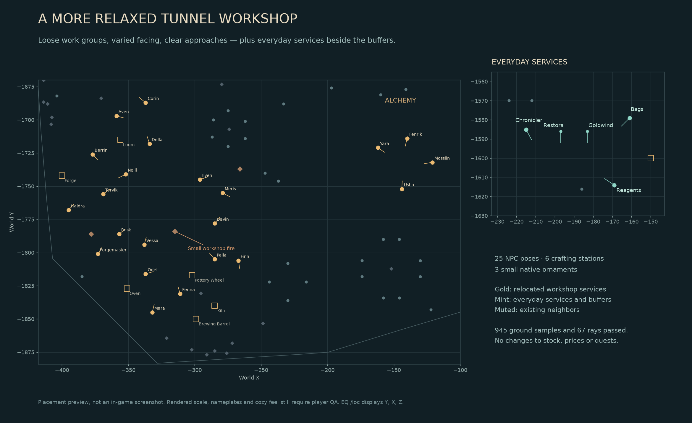

# Relaxed tradeskill workshop — October 13, 2026 candidate

**Owner-approved for main and live QA; activation pending.** The owner requested
less rigid tradeskill rows, room to move, a cozy atmosphere, and the Chronicler,
bag merchant and spell reagent vendor beside the buff bots. This candidate is
based on current production content captured October 13 at 12:32 UTC, including
Artisan Veyra. It does not reapply the October 2 full-tunnel layout.



## Arrangement

The 21 dedicated tradeskill suppliers and Epic Forgemaster form staggered work
areas: smithing/tinkering in the west, textiles and small crafts to the north,
research and poison near a small workshop fire, kitchen/pottery in the south,
and an alchemy gathering in the space vacated by the Chronicler. NPCs face usable
approaches at varied angles. The closest changed object/actor to another static
object/actor is 14.10 units; all existing walking routes remain clear.

The Ancient Chronicler, Bartholomew Packwell and Tessa join Matron Restora and
Magus Goldwind. Each relocated service is less than 35 world units from a buff
bot. The buffers remain in place. Coordinates below use EQ `/loc` order **Y, X, Z**.

| Service | New /loc | Existing service retained |
|---|---|---|
| Ancient Chronicler | -1585, -215, 3.75 | Choose / view classes |
| Bartholomew Packwell | -1579, -161, 3.75 | Bags and containers |
| Tessa | -1614, -169, 3.75 | Food and spell components |
| Matron Restora | -1586, -197, 3.75 (unchanged) | Blessings |
| Magus Goldwind | -1586, -183, 3.75 (unchanged) | Premium blessings |

All six functional crafting stations move with their work areas. The three new
ornaments are a small CAMPFIRE, BARREL3 and HANGLANT, reusing native models
verified in the installed `ecommons_obj.s3d`. No new client assets are needed.
Names, models, stock, prices, recipes, quest bindings, class courts, residents,
native services, Artisan Veyra and all eight walking routes are preserved.
[Exact relocated NPC roster](roster.md).

## Implementation and proof

- `tools/tunnel_cozy_layout.py`: exact 25 NPC poses, six station poses, three ornaments.
- `tools/tunnel_cozy.py`: fresh capture, topology checks, serializable preimage-guarded
  SQL, strict mutation scope and fresh-state rollback target. Generation does not
  execute SQL. External spawn references, shared groups, duplicate keys, moving or
  cross-zone owned spawns and global/cross-version door collisions fail closed.
- Only relocated actors' non-corpse, non-metadata, instance-zero EC caches are
  invalidated. Dormant cache rows with NPC ID zero require matching spawn/group
  identity. Corpses, other instances, metadata and unrelated actors are retained.
  Ambiguous owned cache identity is rejected. Rollback never restores old caches.
- Nine focused unit tests pass, including preserved Veyra access, interactive
  donor rejection, gameplay mutation rejection, replay and fresh-state rollback.
  Eleven checks pass against the real captured schemas/rows in a disposable local
  MariaDB database; that schema was removed. [Database evidence](database-checks.json).
- The scene probe passes 945 ground samples and 67 rays, NPC/station/furniture
  spacing, all eight current patrol paths, changed service approaches and unchanged
  neighboring service approaches. [Geometry evidence](geometry-summary.json).
- Local and production `ecommons.map` SHA-256 both equal
  `861fa497df139138b13d08b6e16f2d50c6f1a0ccc3f0fa4ce0afadddb6a17915`.
  [Installed model evidence](asset-check.json). Native source permits dynamic-zone
  interactions before opentype checks, so ornament donors with interaction fields
  are rejected, even when their model is otherwise acceptable.
- Independent review found and corrected a Veyra frontage obstruction and a
  possible interactive-donor inheritance. Both have regression coverage. The
  diagram was rendered and inspected; it is not an in-game visual acceptance.

Private source snapshots, generated SQL and full probe output are retained in
`E:/EQ_Local_Dev/artifacts/tunnel-cozy-20261013/`. The public proof contains no player
snapshots. The live server was read only throughout the initial candidate work.

Focused commands (from this checkout):

```powershell
python -m unittest discover -s tools/tests -p test_tunnel_cozy.py -v
python tools/tests/rehearse_tunnel_cozy.py --source <fresh-snapshot.json> --evidence <private-output>
python tools/tests/probe_tunnel_cozy.py --snapshot <fresh-snapshot.json> --evidence <private-output>
```

## Application and recovery boundary

The owner explicitly approved this candidate's promotion to main and deployment
for live QA on October 13. This is release-specific authorization; owner visual
acceptance remains separate. PR #194 tracks the approved release.

`ops/rollout.py` retains the original game/gateway containers and all binaries,
uses both deployment/GM file locks and checks the GM SQL fence, takes a stopped
full backup, and restores it into an isolated temporary MariaDB container before
the forward/inverse rehearsal. Twelve fault-injection tests in `ops/test_rollout.py`
cover absent recovery baselines, uncertain SQL commit, rehearsal failure, fresh
activity after possible access, player/cache drift and recovery reopening errors.
An unverified recovery leaves the gateway closed. Market rows are exact around
SQL/rehearsal; startup may rotate the epoch/offers while policy remains unchanged.

After approval, use the current production maintenance/deployment fence and
retain the current image, binaries, client release, quests and all other runtime
files. Announce the maintenance interruption to the owner. Take a fresh verified
full backup, capture again after the runtime is stopped, and compare the static
scene to this reviewed candidate. Do not apply the preview SQL captured while
the server was running. Generate `desired(before)` and `patch_sql(before, after)`
from the stopped fresh capture; rehearse on an isolated restored copy before
applying. Abort on static drift or unexpected preservation differences.

Use the currently supported controlled runtime restart/maintenance procedure;
never kill a single production zone, since the supervisor restarts the whole
runtime on child exit. A DB edit or `#repop` alone is not a verified refresh of
all NPCs, stations and door objects. On restart, verify exact static afterimages,
all unchanged player/custom/merchant tables, matching running binaries, healthy
native processes and public access. No client update is paired with this change.

For rollback, under the same maintenance fence capture current state and call
`rollback_target(original, current, expected)` then `patch_sql(current, target)`.
Intervening static edits block rollback rather than being overwritten. Only the
three owned ornaments are removed and the owned poses restored; fresh unaffected
saved states remain. Never restore an old player database or old NPC state rows.

## Exact in-game QA after activation

1. In East Commonlands, visit `/loc -1595,-188,4`. Confirm the two buffers, Chronicler,
   Bartholomew and Tessa form an open service nook with readable names and clear
   click approaches. Hail the Chronicler and each buffer, open the bag merchant,
   and buy a spell reagent from Tessa. Confirm the former positions are empty.
2. Walk the workshop from `/loc -1705,-350,4` south to `/loc -1850,-300,4`.
   Check every NPC in the roster, including all Roman-numbered supplier pages.
   Inspect varied facing, spacing and the overall cozy feel at player height.
   No floating, wall intersection, overlapping names or blocked clicks should occur.
3. Visit the alchemy group around `/loc -1735,-144,4`; open all four suppliers.
   Verify the new grouping feels connected and easy to find from the workshop.
4. Open and close the Loom, Oven, Forge, Brewing Barrel, Pottery Wheel and Kiln.
   Each must keep its normal combine-container behavior. Hail Epic Forgemaster
   and interact with Artisan Veyra from her existing front approach.
5. Inspect the small fire, barrel and lantern; check their size, grounding,
   visibility and lack of gameplay interactions. Walk all gaps and observe the
   existing walkers for several minutes, especially around the kitchen and research.
6. Zone out and back; confirm the new poses persist, no duplicates return, and
   existing class courts, six campfire residents and native services are intact.
   Record owner acceptance separately from automated checks and deployment.
