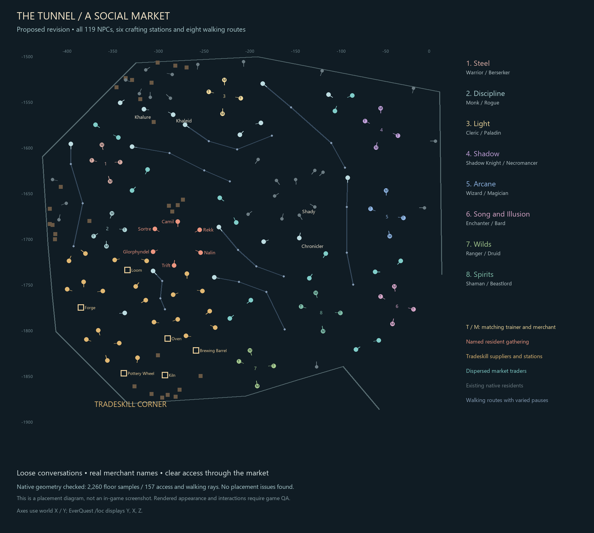

# Social tunnel revision

Status: [deployed October 2](PRODUCTION.md); rendered owner acceptance remains
open. This corrects the owner's live visual QA of the
September 30 class-court layout. The owner requested social congregations, real
class merchant names, dispersed traders, wandering residents, the Chronicler by
Shady, an imperfect gathering of the six named residents, and a tradeskill corner.

The [complete roster](roster.md) accounts for all 119 NPC actors: 26 native
services, 32 class actors, 16 market traders, 22 supply merchants, eight walkers,
nine custom services and six named residents. Native service positions remain
intact. All six previously off-tunnel residents are explicitly included;
Glorphyndel is 999526, while Khalure remains the Druid Rings service.

Eight loose class gatherings retain adjacent trainer/merchant counterparts and
matching uniforms. The 16 renamed merchants retain class 41, merchant IDs
99300-99315, role subtitles, inventory, prices and appearance. The southwest
tradeskill corner contains all supply pages, the six existing crafting stations,
and the Epic Forgemaster. All 16 market traders remain spread around the chamber.
The Chronicler stands 25 units south of Shady with clear access to each.

The six residents face an uneven open ring. At staggered intervals they turn
toward companions and sometimes nod or wave. This is silent; existing OOC cadence
does not change. Hailing delays the gestures, and nearby players or combat
suppress them. Glorphyndel now has a hail greeting and returns unintended hand-ins.
All eight walking routes have distinct pauses with native Random Half variation.

## Verification

- 119-actor scene audit; 2,260 native floor samples and 157 access/path rays pass.
- 13 existing court tests and 14 social-layout tests cover roster, formation,
  identity/stock links, mutation budget and scoped state handling.
- 25 social Perl assertions and 21 existing resident assertions pass.
- 17 disposable MariaDB checks pass: collision/drift/replay rejection, exact
  numeric afterimages, fresh rollback and player/stock/native-state preservation.
- Independent review checked source, generated content and Perl API bindings.
- 25 rollout fault checks cover preflight drift, closed access on activation
  failures, and exact restoration of both replaced and newly added quest files.

The terrain checks include every actor, all six moved station footprints,
stationary NPC/furniture clearance, continuous service approaches, and sampled
walker segments with shoulder-width collision rays. The picture is a placement
diagram, not proof of client rendering or completed owner acceptance.

## Exact in-game QA

Use East Commonlands, instance 0. Coordinates below follow `/loc`: Y, X, Z.

1. Visit `-1707, -274, 3.75`. Find Sortre, Camil, Rekk, Nalin, Trift and Glorphyndel
   in an uneven inward-facing ring. Walk into and around it; no resident may be
   underground, floating, inside another actor or blocking the aisle. Confirm
   their established race, armor and weapons remain recognizable.
2. Stand 25-70 units from the gathering for two minutes. Residents should make
   occasional independent turns/nods/waves. Approach within 20 units or hail one;
   it should attend to the player. No extra OOC stream should appear. Trift must
   still mention his Butcherblock corpse and goblin; Glorphyndel should greet you.
3. Walk the eight class gatherings shown above. Every trainer must be beside
   their named matching merchant, turned toward the gathering rather than in a
   sales line. Check all 16 trainer roles and merchant subtitles against the
   roster. Open training and each stock list; no class/stock page may disappear.
4. Visit the tradeskill corner around `-1780, -330, 3.75`. Find the Loom, Oven,
   Forge, Brewing Barrel, Pottery Wheel and Kiln plus all supplies. Open each
   station and each supply page; multi-page subtitles must remain Roman I-IV.
   Perform an ordinary legal combine and confirm materials/results persist.
5. Visit Chronicler at `-1702, -141, 3.75` and Shady at `-1677, -141`.
   Hail the Chronicler and open Choose/View Classes without changing a class.
   Open Shady's shop. Both must be accessible from the central aisle.
6. Follow each of Alwen, Borin, Cassia, Darik, Esme, Galen, Hessa and Iven through
   a full out-and-back route. They must walk, pause for varied durations, reverse
   at their endpoints, and avoid pillars, crafting stations and standing groups.
7. Hail dispersed market traders, open an ordinary offer and reject it. Existing
   market behavior, quantities and stock rules must remain intact. Check the
   native merchants, adventure services, bags, blessings and waypoint service.
8. Hail Khalure (Druid Rings) and Khaleid (Wizard Spires). Verify their existing
   subtitles and travel options. Rezone and reconnect; the revised placements,
   names, stock and resident behavior must persist.

## Release and recovery

Use a fresh stopped-server capture under the production deployment lock and a
verified backup. `tools/tunnel_social.py` only generates guarded content SQL.
It refuses identity drift, shared references, wrong grid modes and ambiguous
saved-state dependencies. Invalidate only the 93 relocated actors' correct
instance 0/non-corpse cached states. Preserve unchanged native caches, player
data, merchant stock and the current native image. Restore only scoped content
and the seven affected quest/plugin files during rollback; never restore an old
full database over later play.

The release helper in `ops/rollout.py` keeps access closed through SQL, runtime,
quest, preservation and native process verification. The operator then checks
four TLS-protected public native handshakes before recording final activation;
failed activation closes access. `verify` is a read-only health, static content,
map and installed-file audit, not a comparison against old player fingerprints.
The game container alone is recreated from its pinned existing image, with
`--no-deps`, giving this activation a fresh restart counter. The database is not
recreated.

The existing owner instruction to push the ongoing tunnel work to main and the
server is retained. That authorization is separate from acceptance of the new
in-game appearance. [Production evidence](PRODUCTION.md) records the completed
activation and remaining owner QA.
