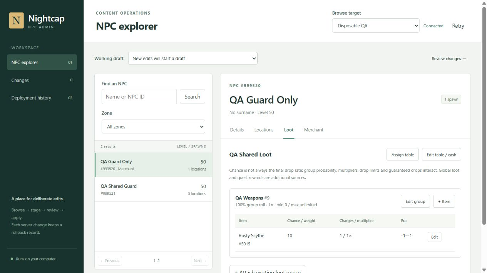

# Nightcap NPC Admin

A local GM workbench for NPC placement, loot, combat, appearance, respawns and
merchant stock. Browse → stage → review → apply. Drafts never write gameplay data.



## Start

Requires Node.js **22.12+** (or 24+) and Git. From this folder:

```powershell
npm ci --ignore-scripts
node scripts/setup-local.mjs E:\EQ_Local_Dev
npm run build
npm start
```

Open **http://127.0.0.1:3100**. Or double-click **Start NPC Admin.cmd**; it installs
missing dependencies, builds the UI and opens your browser once the server listens.
Keep its console open; Ctrl+C stops the app. `npm run dev` enables UI hot reload.
All npm commands run in `eq-npc-admin`, never the repository root.

`setup-local.mjs` imports the existing local EQEmu database credentials into ignored
`config.local.json` without printing them or overwriting an existing file. Start
Docker first; local PEQ uses **3307**. If you do not use the existing workspace,
copy `config.example.json` instead and enter credentials locally. With no config,
the app opens a setup screen. Never commit `config.local.json` or `.local/`.

## Everyday tasks

| Task                  | Workflow                                                                                                                                                                                                                                 |
| --------------------- | ---------------------------------------------------------------------------------------------------------------------------------------------------------------------------------------------------------------------------------------- |
| Move an NPC           | Search name/ID and zone → Locations → select a map marker → Move / edit selected spawn. Paste `/loc` in **Y, X, Z** order; the editor maps axes. Set heading in 0–511 units. Current circles and staged diamonds show the proposed move. |
| Adjust respawn        | Locations → Move / edit → respawn seconds, variance, path grid or animation. The UI shows other NPCs sharing the spawn group.                                                                                                            |
| Edit loot             | Loot → table/cash, group probability and drop limits, or item odds/charges/era gates. `+ Item` searches item names; attach an existing group by ID. Shared NPCs and global-loot rules appear in preflight.                               |
| Edit NPC stats/models | Details → Edit details or Edit combat. Every spawn using that NPC template changes. Race, class, texture and faction values are database IDs.                                                                                            |
| Stock a merchant      | Merchant → assign merchant ID/class or add/edit/remove stock. Class 41 opens a merchant shop. The sixteen curated PoK class merchants remain managed by the catalog/restock tooling.                                                     |
| Review or share       | Changes → before/after diff, Unstage, Export change set, View SQL or Import JSON. Up to 200 records per draft. Drafts survive restart.                                                                                                   |
| Undo a server change  | Deployment history → Preview rollback → inspect drift/activation → confirm the exact target name. Rollback refuses newer content or conflicting saved state.                                                                             |

This replaces repetitive SQL requests to Codex with immediate context and review.
Use Codex for new quests, C++/schema changes, encounter analysis, unusual data
repairs, new NPC/spawn creation, or cloning independent loot tables. This release
edits existing NPCs and spawn records; it adds/removes loot and merchant entries.
It does not create NPC templates, spawn groups, path grids or new loot containers.

## Zone maps

Set `mapDirectory` in the ignored `config.local.json` to your client's `maps`
folder, for example `E:/EQ_Local_Dev/Client_RoF2_Dev/everquest_rof2/maps`, then
restart NPC Admin. Relative paths resolve from the app folder. The backend reads
`zone.txt` and optional `zone_1.txt` through `zone_3.txt`; client files remain
read-only and are not copied to Git. Missing maps retain a labeled coordinate view.

Locations shows the selected NPC's configured spawns for one zone/version.
Drag to pan, scroll or use +/− to zoom, and use Fit zone / Fit spawns. Focus the map
and use arrow keys to pan. Select a marker or the spawn picker, then use the
existing location editor to stage a move. Navigation never changes coordinates.
Staged moves show current circles, proposed diamonds and connecting lines.
Map labels and layers can be toggled; **Limit height** clips outlines and markers
to a Z interval. **Height near selected spawn** starts at its proposed Z ±20.

These are database spawn positions, not live roaming NPCs. Client map labels can
be outdated and are separate from NPC data. Map layer numbers are file layers,
not reliable floor numbers. Height filtering helps with overlapping floors but
does not prove ground clearance, line of sight, collision or pathing. Verify
placement in game. Zone maps default to the zone short name for all versions;
match the chosen map to the actual era/client terrain. For alternate maps set
`mapAliases`, for example `{"lavastorm:0":"lavastorm_classic"}` when those files
exist. A target's `mapAliases` overrides the global alias set. Only map basenames
are accepted; absolute paths, traversal and files outside the folder are refused.
The app limits a map to 8 MB / 120,000 lines / 5,000 labels and caches four maps.

## Push to GitHub

Set `repository` (relative to this app or absolute), `gitRemote` and `gitBase` in
the local config. The example uses `origin` and `main` as the content baseline.
Use the baseline matching your content release; `gitBase` is a **local ref** and
must be fetched/updated through your normal Git workflow. Configure Git identity
and authenticate the existing remote once on this computer.

**Push content branch to GitHub** creates
`feature/npc-change-<draft-id>-r<revision>` containing exactly four files under
`content/npc-changes/<draft-id>/r<revision>/`: JSON, forward/reverse review SQL,
and activation/QA notes. An isolated worktree preserves your dirty or staged
checkout. The app verifies the remote commit. It never merges or promotes a branch.
Follow `feature → dev → test → main`; main still requires owner in-game sign-off.

If commit or push fails, correct Git identity/authentication and retry. The retained
manifest pins the base, files and commit. Unselected modifications or extra commits
are refused. Do not edit `.local/git-worktrees` manually. Review SQL is documentation,
not a standalone deployment script; apply the JSON through the app for safeguards.

## Apply to a server

Named profiles let you browse one database and apply the same portable draft to
another. The target must match the full original records and schema defaults;
preflight refuses drift rather than overwriting it. A hosted profile uses verified
TLS or an owner-managed local SSH tunnel, for example:

```powershell
ssh -N -L 127.0.0.1:3308:127.0.0.1:3306 your-user@your-server
```

Use that target's actual database port on the **right** side, then point its profile
at local port 3308. Keep the tunnel running. The app does not manage SSH keys or
restart hosted services. Mark a production profile with `"production": true`.
Connection credentials are read by the local backend and never sent to the UI.

For Nightcap's **OVH** stack, the database is private inside Docker: there is no
host `127.0.0.1:3306` listener. From `/opt/nightcap/deploy/production`, identify the
`db` container with `sudo docker compose ps -q db`, then inspect its private bridge
address. Use that address as the tunnel's remote destination (port 3306), and
recheck it after container recreation. Do not publish a database port or weaken
the existing gateway/Cloudflare policy. Use the hosted DB credentials, not the
local akk-stack credentials. Follow [hosted operations](../deploy/production/README.md).

Choose **Apply target → Preview server changes**. Review affected NPCs/zones,
shared loot/global rules, conflicts and saved state. For placement, stop the affected
zones and instances before confirming maintenance. Type the destination's exact
label and apply. The backend rechecks the preview inside a serializable transaction,
writes a local before-image, updates only selected records and scoped state, then
commits a database receipt. Tables must be InnoDB. The first apply creates the small
`npc_admin_deployments` ledger; the DB user needs CREATE for that table plus SELECT,
INSERT, UPDATE and DELETE on the relevant content/state tables. A DBA may create
the ledger with the schema in `api/changes.mjs` and then remove CREATE permission.

Placement removes only reviewed non-corpse/non-zone state for the affected spawn
IDs in their actual zones. Affected instance-specific state is blocked. Rollback
restores original rows only when IDs are free and no newer matching state exists.
Take the normal full PEQ backup before live work (`tools/backup-peq.ps1`); app
before-images complement that backup. Copy `.local` to preserve drafts and receipts
when moving the app, and retain the database ledger with DB backups.

If a connection fails during commit, history shows an uncertain/prepared receipt.
Use **Recover outcome** before attempting anything else: the transactional database
ledger establishes whether that attempt committed. Losing either receipts or the
ledger prevents reliable automated recovery. A rolled-back revision cannot be
applied again under the same operation ID; import it as a new draft and preflight.

## Activation and acceptance

Database applied does **not** mean the running zone loaded the change:

- Placement: stop affected zones before apply; start them afterward. A plain repop
  is insufficient when saved state can restore the old position.
- NPC templates and merchant stock: restart affected zones. `#repop` alone does not
  refresh these caches.
- Loot: regenerate shared memory (`./bin/shared_memory` in the server directory),
  then restart affected zones. Follow the server's existing deployment runbook.
- Confirm coordinates, heading, ground height, pathing, merchant inventory and drop
  behavior in game. Test combat changes against representative legal player builds.

The app never kills zones or changes era rules. The exact acceptance rehearsal and
dated test evidence are in [QA.md](QA.md). Manual live acceptance remains owner work.

On OVH, a native child exiting restarts the entire game runtime under
`/opt/nightcap/start.py`. Use its supported zone-unload mechanism or the approved
maintenance procedure; local eqlaunch single-zone restart behavior does not apply.

## Verification

```powershell
npm test
npm run build
docker run --detach --rm --name npc-admin-test --publish 127.0.0.1:3317:3306 --env MARIADB_ROOT_PASSWORD=npc-admin-test-only --env MARIADB_DATABASE=npc_admin_test mariadb:10.11
# Wait until MariaDB is ready, then:
npm run test:database
docker stop npc-admin-test
```

Database tests are deliberately hardcoded to disposable `npc_admin_test` on **3317**;
they never use live `config.local.json`. `node scripts/inspect-local.mjs` performs
read-only live schema compatibility checks. No client binaries are modified.

The HTTP service binds only `127.0.0.1`, checks Host/Origin and mutation headers,
and exposes no arbitrary SQL or shell endpoint. It is a single-operator local tool,
not a multi-user hosted admin service. Do not expose port 3100 through a proxy or
port-forward. Run one instance per app folder. New schema differences fail closed;
duplicate loot composite keys require repair before the app can edit them.
